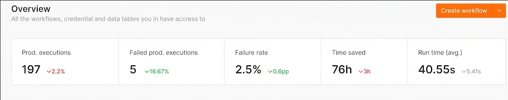

# n8n Automations: work samples

I'm Felipe Mac Auliffe. I work in operations and automation (HubSpot, n8n, Zapier, Make) and I'm looking for remote Customer Success, Customer Support and RevOps roles with US companies.

This repository is a portfolio, not a software library. It holds three automations I built and run every day on my own n8n server. Each one replaces a repetitive human task with a flow that does the routine part and hands the judgment calls back to a person. You do not need to read code to follow it: every folder has a plain-English README that explains the problem, how the flow works and what it produced.

## The numbers behind it

<!-- SCREENSHOT GOES HERE: save the n8n dashboard image as assets/dashboard.png (exact name) and it will show below. -->


*Screenshot of the dashboard of my n8n instance. It covers every workflow on the instance, including some that are not published here, so read it as the overall picture, not as a per-project score.*

How to read those figures honestly:

- **Executions and failure rate** are counted by n8n for the whole instance. Most failures came from one cause: an enrichment service ran out of credits and the workflow stopped. The fix is in this repo (a shared error workflow that sends me an alert instead of failing silently).
- **"Time saved" is an estimate.** n8n multiplies a fixed number of minutes by the number of executions. I trust the per-project method below more, because it counts real outcomes (emails sent, entries logged).

| Project | Real outcome counted | Minutes saved per outcome (my estimate) | Estimated time saved |
|---|---|---|---|
| Lead generation, outbound profile A | 79 prospects contacted | 15 (research, contact lookup, drafting) | about 20 hours |
| Lead generation, outbound profile B | 250+ prospects contacted | 15 | about 62 hours |
| Expense and habit bot | 262 expenses + 216 habit entries logged | 3 | about 24 hours |
| Job search pipeline | 865 listings screened, 92 shortlisted | my manual baseline is about 1.5 hours per screening session | not totalled |

The estimates are deliberately conservative: doing the lead research by hand took me 30 to 40 minutes per prospect, and I only count 15.

## The three projects

### 1. [Lead generation pipeline](lead-gen-pipeline/)
**Problem:** outbound prospecting meant hours of research per lead, and three near-identical workflows had to be maintained separately.
**What I built:** one configurable workflow with six lanes: find leads, score them against an ideal-customer profile, find a decision maker, write a personal email, check it before it can be sent, track replies and prepare follow-ups. A configuration block per lane switches the whole pipeline to another business, language or contact service without touching the logic.
**Result:** the logic ran two different outbound programs (as two separate copies, now merged into this one). One sent 79 emails and about 5% replied (roughly 3% booked a call). The other sent 250+ emails, got about 20 replies and booked 10 calls for the company's sales team.

### 2. [Job search pipeline](job-search-pipeline/)
**Problem:** screening remote job boards by hand took about 1.5 hours per session, and the useful listings were buried under irrelevant ones.
**What I built:** a daily flow that pulls listings from five job sources, filters and de-duplicates them, has a local AI model read each ad, scores it with fixed rules and sends the best ones to a spreadsheet and a morning Telegram digest. A second workflow triages my inbox and pings my phone only when a message is urgent (a recruiter asking for availability, an assessment deadline).
**Result:** 865 listings screened and 92 shortlisted since 7 September 2026. A "heartbeat" check tells me if the morning digest did not go out, so silence never means "nothing happened" by accident.

### 3. [Expense and habit bot](expense-habit-bot/)
**Problem:** tracking daily spending and habits in a spreadsheet was a chore I kept skipping.
**What I built:** a Telegram bot (plus an iPhone shortcut) where I type "supermarket 50k" or "gym 45 min" and the entry lands in the right sheet. Simple rules catch the common phrases; a local AI model only handles what the rules cannot read. Every entry can be undone with one message.
**Result:** 262 expenses and 216 habit entries logged, with a daily 19:00 reminder for whatever I forgot.

## How I approach automation

These are the habits that run through all three projects, and they are the same ones I would bring to a support or customer-operations team:

- **People stay in the loop where it matters.** The outreach flow can run in a "review" mode where every email lands in my own inbox first. I ran it that way for the first two days before switching to automatic sending.
- **Checks before actions.** Nothing is emailed to a prospect unless the draft passes a validation gate (length, language, signature, banned filler phrases, no template leftovers). A failed draft is parked with the reason, not sent.
- **Rules first, AI second.** Fixed rules handle what is predictable (cheaper, faster, explainable). The AI model only extracts facts or writes drafts, and its output is validated before anything depends on it.
- **Local models, private data.** Everything runs on my own machine with open models, so personal emails and finances never leave it.
- **Failures are loud.** Errors raise a Telegram alert, scheduled jobs have a heartbeat, and a failed send never marks a record as done.
- **Measured honestly.** I report real counts and say how each estimate is made.

## What is in the repository

```
lead-gen-pipeline/     one configurable workflow + two example profiles + sheet template
job-search-pipeline/   daily job screening workflow + inbox triage workflow + sheet template
expense-habit-bot/     Telegram and iPhone bot workflow + sheet template
shared/                error notifier used by all workflows
tests/                 offline checks for the logic inside the workflows
scripts/               leak scanner used before every commit
.env.example           checklist of every credential and ID you would need to supply
```

The workflow files are n8n exports, so they can be imported into any n8n instance (Workflows, then Import from file). They are inactive by default and contain no credentials.

## Privacy and safety

Everything here was sanitized before publishing: no API keys, tokens, webhook URLs, spreadsheet IDs, chat IDs, email addresses or client names. Each is replaced by an obvious placeholder (`YOUR_...`, `REPLACE_WITH_YOUR_CREDENTIAL`) and listed in [`.env.example`](.env.example). Company-specific targeting and wording in the lead generation profiles were replaced with generic examples. A scanner (`scripts/scan.sh`) checks every commit for secrets and personal data.

## Stack

n8n (self-hosted, Docker), Ollama with open models (Qwen, Llama), Google Sheets as the data layer, Telegram, Gmail, Hunter, Apollo, Adzuna.

## License

MIT. See [LICENSE](LICENSE).
